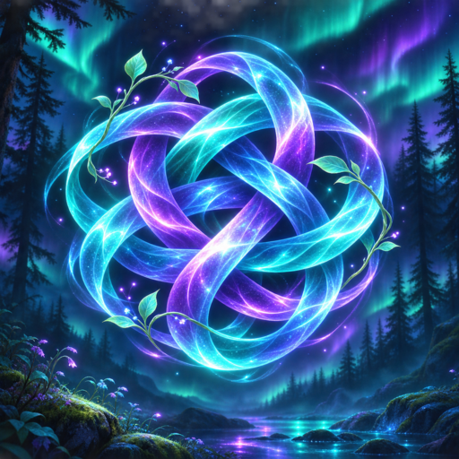

<div align="center">
  
  <h1>ArkVisuals</h1>
  <p><strong>Магия деталей. Твой мир — твои визуалы.</strong></p>
  <p>Клиентский Fabric-мод с набором частиц и HUD-эффектов, которые можно подстроить под себя.</p>
  <p>
    
    
    
    
  </p>
</div>

## Возможности

ArkVisuals — визуальный мод, а не чит: он не меняет механику, не отправляет команды и не требует установки на сервере. Все эффекты создаются локально и отключаются по отдельности.

### Частицы
- Магический след за движением и искры шагов.
- Парящие частицы ауры, лесные огоньки в темноте, искры дождя и ночные мерцания.
- Всплески при прыжке и приземлении, пузырьки под водой, частицы лечения и критического падения.
- Портальная аура и частицы действующих эффектов.

### HUD и экран
- Координаты, игровое время, направление, броня и уровень опыта.
- Акцент панели быстрого доступа, пульс при низком здоровье, мягкая вспышка урона и ритмичное свечение.
- Самостоятельный HUD: координаты, время, направление, броня и опыт. Стандартный прицел Minecraft не меняется.
- Для HUD настраиваются цветовая тема, плотность визуальных частиц, масштаб и угол размещения.

Визуалы работают не только на игроке: листья рядом шелестят частицами, водоёмы мерцают, а вокруг животных появляются огоньки. Всего — **26 независимых переключателей** на трёх страницах. Список прокручивается колёсиком мыши, перетаскиванием ползунка или клавишами ↑/↓ и Page Up/Page Down. Настройки записываются в `config/arkvisuals.json`.

## Установка и управление

1. Установи Fabric Loader и Fabric API для Minecraft **1.21.4**, запусти игру один раз.
2. Помести `ArkVisuals.jar` в папку `mods` и снова запусти игру.
3. Нажми **N** в игре, чтобы открыть панель. Изменения сохраняются автоматически; **Esc** закрывает окно.
4. Клавиша видна и переназначается в **Настройки → Управление → Назначение клавиш → ArkVisuals**.

## Сборка из исходников

Нужны JDK 21 и Gradle 8.11.1:

```bash
gradle build
```

Готовый мод появится в `build/libs/ArkVisuals.jar`. GitHub Actions также собирает JAR для каждого push и pull request и прикладывает его к артефактам запуска workflow.

### Версии Minecraft

Текущая исходная сборка и метаданные рассчитаны на **1.21.4**. Fabric-моды зависят от версии Minecraft, маппингов и Fabric API; поэтому диапазон «1.21.4–26.2» нельзя честно объявить одним проверенным JAR без отдельных сборок и тестирования каждой версии. Проект открыт для портирования на следующие версии вплоть до 26.2, но в этом первом исходном выпуске совместимость с 26.2 **не заявляется**. Версии задаются в `gradle.properties`; для порта нужно обновить согласованный набор Minecraft/Yarn/Fabric API и проверить API интерфейсов.

## Настройка / разработка

- `src/client/java/dev/arkvisuals/config/VisualFeature.java` — список визуалов и страницы панели.
- `VisualConfig.java` — значения по умолчанию, цветовые темы и сохранение JSON.
- `ArkVisualsClient.java` — клиентские эффекты и отрисовка HUD.
- `VisualsScreen.java` — внутриигровая панель.

Pull request с новыми эффектами, настройками и версиями приветствуются. Пожалуйста, сохраняйте мод клиентским, не добавляйте игровые преимущества и проверяйте, что эффекты можно отключить.

## Лицензия

MIT. См. [`LICENSE`](LICENSE).
